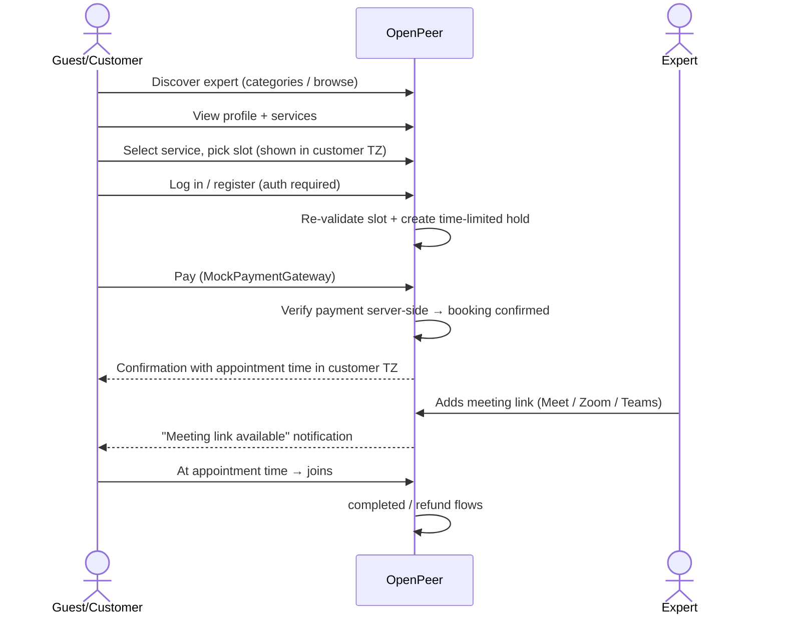

# Task 0.1 — Product Scope & MVP Definition

- **Project:** OpenPeer
- **Phase:** 0 — Architecture & Planning (Output 1 of 5: MVP Feature Matrix)
- **Status:** ✅ Approved by user — completed (planning only; no repository code changes)
- **Date:** 2026-10-20
- **Source:** Master Development Prompt v3.0, §3, §6, §7, §12, §13, §14
- **Note:** This file was persisted at the user's explicit request (deviation from the "Phase 0 outputs stay in chat" rule, approved by the user). It is a planning artifact — no code, migrations, or configuration were touched.

---

## 1. Product Boundary Statement

**OpenPeer MVP:** A marketplace core where experts create a profile, paid services, and availability definitions; where customers can run the **discover → pick slot → pay → join via meeting link** flow end-to-end through a `MockPaymentGateway`; and where the ownership of booking state, availability, and payment status lives in OpenPeer's own database. It excludes: custom video infrastructure, real payment providers, calendar integrations, and queue infrastructure.

Three boundary principles that constrain downstream decisions:

1. **Scheduling, booking, and payment state are OpenPeer's data.** Google Calendar etc. are integrations — never the source of truth.
2. **Monetary and heavy infrastructure are deferred:** no real payment provider (Mock gateway only); no self-hosted video infra.
3. **Dual roles on one account:** `Customer` and `Expert` share one account; authorization is enforced server-side via Gates/Policies.

## 2. Roles & Authorization Matrix

| Capability | Guest | Customer | Expert | Admin |
|---|:---:|:---:|:---:|:---:|
| View published profiles (`/experts/{slug}`) | ✓ | ✓ | ✓ | ✓ |
| Browse services | ✓ | ✓ | ✓ | ✓ |
| View available slots | ✓ | ✓ | ✓ | ✓ |
| Start the booking flow (up to checkout) | ✓ | ✓ | ✓ | ✓ |
| Register / login / logout / password reset / email verification | ✓ | ✓ | ✓ | ✓ |
| Manage account settings | — | ✓ | ✓ | ✓ |
| Create booking & pay | — | ✓ | ✓ | ✓ |
| View own appointments (upcoming / past) | — | ✓ (own only) | ✓ (own services) | ✓ |
| Access meeting links | — | ✓ (own bookings) | ✓ (own services' bookings) | ✓ (moderation) |
| Cancel per cancellation policy (refund rules apply) | — | ✓ | ✓ | ✓ |
| View payment history | — | ✓ (own) | ✓ (earnings view) | ✓ (all) |
| Create / edit / publish own profile | — | — | ✓ (own only) | ✓ |
| Service CRUD, price & duration | — | — | ✓ (own only) | ✓ |
| Booking management (add meeting link, cancel) | — | — | ✓ | ✓ |
| Earnings overview | — | — | ✓ | — |
| User & expert management, moderation | — | — | — | ✓ |
| Platform configuration | — | — | — | ✓ |

**Data isolation principle (master prompt §9):** a customer sees only their own bookings; an expert sees only bookings tied to their own services. Meeting links must never appear on public pages, in logs, or in unauthorized frontend data.

**Role model recommendation (to be finalized in task 0.3):** no separate `roles` table for MVP; "being an expert" is represented by the existence of an `expert_profile` record; authorization via Policies (and `can()` gates).

## 3. MVP Feature Matrix

Status codes: **MVP** (in scope) · **POST-MVP** (after MVP, separate approved tasks) · **OUT** (explicitly out of MVP scope). Phase labels refer to master prompt §14 (P1 Foundation … P6 Expansion).

| # | Area | Feature | Status | Phase | Notes / Rationale |
|---|---|---|---|---|---|
| 1 | Foundation | Laravel 13 + React starter kit initialization | MVP | P1 | **Already present in repo** (commit `cb54886`) — task 1.1 becomes verification |
| 2 | Foundation | PostgreSQL configuration and initial migrations | MVP | P1 | |
| 3 | Foundation | Docker (application + PostgreSQL) | MVP | P1 | No Redis / queue workers |
| 4 | Foundation | Keep and verify starter-kit authentication | MVP | P1 | Do not rewrite |
| 5 | Foundation | Base UI + public/dashboard layouts | MVP | P1 | |
| 6 | Foundation | Pest / Pint / PHPStan + setup documentation | MVP | P1.6 | |
| 7 | Identity | Registration, login, logout | MVP | P1 | From starter kit |
| 8 | Identity | Password reset, email verification | MVP | P1 | From starter kit |
| 9 | Identity | Account settings | MVP | P1–P2 | |
| 10 | Identity | Secure session handling + rate limiting | MVP | P1 | Starter configuration |
| 11 | Profiles | Expert profile CRUD (headline, bio, avatar, languages, timezone, social links) | MVP | P2 | |
| 12 | Profiles | Unique username/slug + reserved system paths | MVP | P2 | |
| 13 | Profiles | Publication status (draft / published) | MVP | P2 | Only published profiles are public |
| 14 | Profiles | Public profile page (`/experts/{slug}`, basic SEO) | MVP | P2 | |
| 15 | Categories | Category entity + assignment to profiles/services | MVP | P2 | Simple list-based categories |
| 16 | Discovery | Basic browsing by category | MVP | P2 | No advanced filters |
| 17 | Discovery | Advanced search / filtering / discovery | POST-MVP | P6 | Master prompt §13 |
| 18 | Services | Service CRUD: duration, price, currency, min notice, max horizon, buffers, cancellation policy, status | MVP | P2 | Money stored as **integer minor units** |
| 19 | Services | Publication control (active / inactive) | MVP | P2 | |
| 20 | Scheduling | Weekly recurring availability (multiple intervals per day) | MVP | P3 | |
| 21 | Scheduling | Date-specific exceptions, days off, blocked periods | MVP | P3 | |
| 22 | Scheduling | Slot generation (duration, buffers, min notice, max horizon) | MVP | P3 | |
| 23 | Scheduling | IANA timezones + UTC storage + customer-TZ display + DST correctness | MVP | P3 | |
| 24 | Scheduling | Booking holds (time-limited) + expiry making slot free again | MVP | P3 | Expiration must work without a background worker |
| 25 | Scheduling | Double-booking prevention enforced at PostgreSQL level | MVP | P3 | Mechanism decision in task 0.6 |
| 26 | Bookings | Booking lifecycle + state machine | MVP | P4 | Designed in task 0.6 |
| 27 | Bookings | Final price validated on the server | MVP | P4 | Client values never trusted |
| 28 | Payments | `PaymentGateway` abstraction | MVP | P4 | |
| 29 | Payments | `MockPaymentGateway` (success / pending / failure scenarios) | MVP | P4 | Must never confirm paid purchases in production |
| 30 | Payments | Idempotent webhook processing + `webhook_events` record | MVP | P4 | Architecture built even for mock |
| 31 | Payments | Financial record foundations (gross, commission, expert share, provider fees) | MVP | P4 | Basic reporting only |
| 32 | Payments | Refund records (model + mock flow) | MVP | P4 | |
| 33 | Payments | Payout execution / actual money transfer | POST-MVP | P5+ | Concept modeled in `financial_entries`; no custody in MVP |
| 34 | Payments | Real Iyzico / Stripe integrations | OUT | P5 (approval) | Separate approved task |
| 35 | Meetings | `ManualMeetingProvider`: expert adds link, URL scheme validation (https), participant-only access, customer notification | MVP | P5 | Links never leak publicly |
| 36 | Meetings | Google OAuth + Calendar lookup + Google Meet creation | OUT | P5 (approval) | Separate approved task |
| 37 | Meetings | Own video infra (WebRTC / SFU / TURN) | OUT | — | Not in MVP at any phase |
| 38 | Meetings | Meeting-link reminders for experts | POST-MVP | P5 | Requires scheduler / queue |
| 39 | Notifications | Booking confirmation, payment failure, meeting link available, cancellation, refund update (email, sync) | MVP | P4–P5 | Laravel Notifications, **sync** |
| 40 | Notifications | Appointment reminders (scheduled) | POST-MVP | P5 | Needs reliable async infra (later decision) |
| 41 | Dashboards | Customer dashboard (appointments, payment history) | MVP | P1–P4 | Fills progressively |
| 42 | Dashboards | Expert dashboard (overview, profile, services, availability, bookings, earnings summary) | MVP | P2–P5 | |
| 43 | Dashboards | Admin (users, moderation, bookings, transactions, platform config) | MVP | P4–P6 | Simple screens |
| 44 | Infra | GitHub Actions CI | POST-MVP | approved task | |
| 45 | Infra | Redis / queue workers / Laravel Horizon | OUT | P5 (approval) | Separate approval required |
| 46 | i18n | English-first UI + translation-ready structure | MVP | continuous | Turkish etc. later |
| 47 | Deployment | Self-hosted setup documentation | MVP | P1.6 | Aligns with Community goal |
| 48 | Deployment | Production readiness (backups, monitoring, regulation) | POST-MVP | separate assessment | Master prompt §12 |
| 49 | Expansion | Group sessions, live events, YouTube live, courses, course access, digital products, memberships, subscriptions, discount codes, ratings/reviews, public API, developer webhooks, booking widgets, organizational accounts | OUT | P6 | Each an independently approved task/group |
| 50 | Expansion | Multi-currency, white-label, embeds | OUT | P6 | |
| 51 | Platform | Separate multi-tenancy platforms (Community vs Cloud) | OUT | — | Single codebase; no MVP separation |
| 52 | Platform | Custody of customer funds / custom payment logic | OUT | — | Requires legal/technical authorization |

## 4. Product Flows

### 4.1 Customer (Booking Flow) — primary flow

**Critical rules embedded in this flow:** a hold locks the slot during payment but never depends on a background worker; confirmation requires only trusted server-side payment verification; delayed / duplicated / out-of-order payment results are designed in tasks 0.6–0.7.

### 4.2 Expert onboarding flow (summary)

Register → email verification → create profile (draft) → choose categories → define services (price / duration / buffers) → define availability → **publish** → receive booking → add meeting link → hold session → `completed` → earnings overview (record level only).

### 4.3 Admin flow (summary)

Moderation queue (profiles / services) → user & expert inspection → booking / transaction review → refund review → platform configuration.

## 5. Explicitly Out of MVP Scope

None of the following may enter MVP implicitly at any phase: custom video infrastructure (WebRTC/SFU/TURN), real payment providers, Google API integrations, Redis / Horizon / queue workers, reminder scheduling, ratings/reviews, discount codes, group/live/courses/memberships/products, public API, developer webhooks, embeddable widgets, organizations / white-label, multi-currency, advanced discovery, fund custody, custom custody-style payment infrastructure.

## 6. Acceptance Criteria Check

- ✅ All §7 MVP features present in the matrix (rows 1–14, 18–32, 35–45).
- ✅ No §13 expansion feature leaked into MVP (rows 49–50 all `OUT`).
- ✅ Every non-MVP feature has a reason / condition noted.
- ✅ Roles and data isolation defined; dual roles possible on one account.

---

## Appendix — Phase 0 Task Plan & Handoff Status

| # | Phase 0 Task | Dependency | Status |
|---|---|---|---|
| 0.1 | Product scope & MVP definition (this file) | — | ✅ Approved & completed |
| 0.2 | Technology decision record (Laravel 13 / PHP 8.3 vs 8.4 verified against repo; Inertia v3, Wayfinder, Fortify, Pest baseline; ID strategy; money representation; deferred tech list) | 0.1 | ✅ Approved (incl. D-01, D-03, D-05, D-06, D-08) — saved at `docs/phase-0/0.2-technology-decision-record.md` |
| 0.3 | Modular monolith: module responsibility map + proposed directory structure | 0.2 | ✅ Approved — saved at `docs/phase-0/0.3-modular-monolith-architecture.md` |
| 0.4 | PostgreSQL data model (tables, PKs, FKs, unique constraints, indexes, delete policies) | 0.3 | ✅ Approved — saved at `docs/phase-0/0.4-postgresql-data-model.md` |
| 0.5 | Mermaid ERD | 0.4 | ✅ Approved — saved at `docs/phase-0/0.5-mermaid-erd.md` |
| 0.6 | Booking & scheduling design (state machine, slot generation, conflict prevention, holds) | 0.4 | ✅ Approved — saved at `docs/phase-0/0.6-booking-and-scheduling-design.md` |
| 0.7 | Payment design (`PaymentGateway`, mock behavior, idempotency, financial records) | 0.6 | ✅ Approved — saved at `docs/phase-0/0.7-payment-design.md` |
| 0.8 | Security assessment + technical risk register + test strategy + Phase 1 task plan | 0.1–0.7 | ✅ Approved — saved at `docs/phase-0/0.8-security-risk-tests-phase1-plan.md` — **Phase 0 complete** |

### Handoff note for the next session/model

1. Follow the master prompt's protocol: **one subtask at a time**, report, and wait for explicit approval before the next.
2. Current Phase 0 state: all tasks **0.1**–**0.8** are delivered, approved, and persisted under `docs/phase-0/` — **Phase 0 is complete.** Next step: approve the Phase 1 plan (§4 of `0.8-security-risk-tests-phase1-plan.md`), then start task **1.1 — Starter Baseline Verification** with explicit approval (one task at a time).
3. Phase 0 forbids source code, migrations, config changes, package installs, Docker runs, and new repo files other than approved planning artifacts.
4. Repository baseline (verified): Laravel 13 + official React starter kit (Inertia 3, React 19, TS, Tailwind v4, shadcn/ui, Vite), Fortify auth, Wayfinder, Pest 4, Pint, PHPStan/Larastan — commit `cb54886`. Foundation task 1.1 is largely pre-completed.
5. PHP version topic: environment runs PHP `^8.3` while the master prompt targets 8.4 — resolved in task 0.2 as decision D-01 (constraint unchanged; production target 8.4; no 8.4-only syntax until dev+CI unify).

*Further task 0.x outputs will be added under `docs/phase-0/` as they are approved.*
