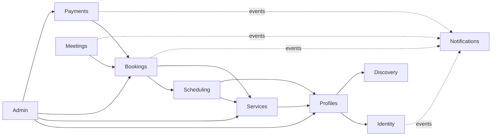

# Task 0.3 — Modular Monolith Architecture

- **Project:** OpenPeer
- **Phase:** 0 — Architecture & Planning (Output: Module Responsibility Map + Proposed Directory Structure)
- **Status:** ✅ Approved — delivered and persisted at the user's request
- **Date:** 2026-10-20
- **Source:** Master Development Prompt v3.0, §5 (Software Architecture), informed by 0.1 (roles) and 0.2 (technology decisions)
- **Evidence:** Starter inventory verified via filesystem inspection; Laravel 13 policy auto-discovery verified at `vendor/laravel/framework/src/Illuminate/Auth/Access/Gate.php:724–745`; default factory resolution verified at `Factory::resolveFactoryName()` (`Factory.php:1086–1099`); explicit provider list confirmed at `bootstrap/providers.php`.

---

## 1. Starter Inventory (facts)

- `app/`: `Actions/Fortify` (Fortify action classes), `Concerns`, `Console`, `Http/{Controllers,Middleware,Requests}` (`Controllers/Settings/{ProfileController,SecurityController}`), `Models/User.php`, `Providers/{AppServiceProvider,FortifyServiceProvider}`
- `bootstrap/providers.php`: explicit provider list (`AppServiceProvider`, `FortifyServiceProvider`)
- Route files: `routes/{web,settings,console}.php`

## 2. Placement Strategy Decision

**Decision:** a **folder-complete modular monolith** under `app/Modules/<Module>/` — each module carries its own `Http/` (controllers + form requests), `Models/`, `Policies/`, `Actions/`, `Events/`, and optional `Contracts/`. Shared areas remain: `app/Console`, `app/Exceptions`, `app/Http/Middleware`, `app/Support`, and `app/Models/User.php` (documented exception — entangled with Fortify; stays in place).

| Alternative | Rejection rationale |
|---|---|
| Full `app/Domain/...` DDD-style layered split | Violates the prompt's "no premature DDD layers" rule; ceremony without MVP payoff |
| Central `app/Http` + module Actions only | Two parallel trees (Http + Modules) tend to decay; form requests encode business rules and must live with the module |

`app/Modules/Integrations` is **not created in MVP** (no dead folders); it appears in Phase 5 when real adapters require it.

## 3. Module Responsibility Map

| # | Module (namespace) | Owned data | Responsibility | Public surface to other modules | Depends on | Forbidden interactions |
|---|---|---|---|---|---|---|
| 1 | Identity | `users` (starter exception), account settings | Wrap Fortify (no rewrite), Gates (`admin` etc.), dual-role representation | `User` model, Gates, role helpers | — (base) | Writing to other modules' domain tables |
| 2 | Profiles | `expert_profiles`, `expert_categories` | Profile CRUD, slug/username (+ reserved paths), publication status, languages/timezone/socials, public page data | `ExpertProfile` (public-field limited), `PublishProfileAction`, `PublicProfileQuery`, `ExpertProfilePolicy` | Identity, Discovery (category FKs) | Writing `categories`; exposing internal user IDs beyond slugs |
| 3 | Discovery | `categories` | Category catalog + simple list query | `Category` (read-only), `ListCategoriesQuery` | — | Writing profile/service tables |
| 4 | Services | `services` | Service CRUD, duration/price/notice/horizon/buffers, cancellation policy, publication, **price-snapshot value generation for bookings** | `Service`, `ServicePolicy`, `PublishServiceAction`, `GetServiceQuery` | Profiles, Discovery (optional) | Touching scheduling/slot logic |
| 5 | Scheduling | `availability_rules`, `availability_exceptions`, **`booking_holds`** | Availability engine (weekly + exceptions + days off + blocks), slot generation (half-open `[start,end)`, TZ/DST), min notice/max horizon, **hold mechanism** (acquire/verify/release/consume; read-time expiry `status='active' AND expires_at > now`), conflict detection (transaction + locks; exclusion-constraint option decided in 0.6) | `CalculateSlotsAction`, `AcquireHoldAction`, `ReleaseHoldAction`, `AssertIntervalFreeAction` | Services (config), Profiles (expert TZ) | Reading payment data; mutating booking state |
| 6 | Bookings | `bookings` | Booking lifecycle (`pending_payment → confirmed → completed/cancelled/expired/payment_failed`), server-side price validation, cancellation policy enforcement | `Booking`, `BookingPolicy`, `CreateBooking` (acquires hold, sets pending), `ConfirmBooking` (only from `PaymentSucceeded` event), `CancelBooking` | Scheduling (hold API), Services (price snapshot), Identity (customer FK) | Writing hold rows directly (must go through Scheduling) |
| 7 | Payments | `payments`, `refunds`, `webhook_events`, `financial_entries` | `PaymentGateway` contract + config-driven driver binding, `MockPaymentGateway`, verification, idempotent webhook processing, financial records (gross, commission, expert share, provider fees, refunds) | `PaymentGateway` contract, `VerifyPayment`, `RegisterRefund`, payment events (`PaymentSucceeded`, `PaymentFailed`, …) | Bookings (booking-id reference & events only) | Reading availability/holds; mutating booking states |
| 8 | Meetings | `meeting_details` | `ManualMeetingProvider` — link CRUD (https, allow-listed hosts), participant policy, "link available" event | `MeetingDetail` (access-guarded), `SetMeetingLinkAction` | Bookings, Notifications (events) | Never exposing links in public pages/logs/unrelated props |
| 9 | Notifications | framework `notifications` table | Event-driven email notifications (confirmation, payment failure, link available, cancellation, refund) — MVP **sync** | — | Events from other modules | Calling other modules' Actions |
| 10 | Integrations | *reserved* | Phase 5: `calendar_connections`, real gateway adapter implementations (contracts stay in owning modules) | — | — | No MVP code |
| 11 | Admin | `platform_settings` | Moderation (policy-guarded), user/expert management, booking/transaction inspection, platform configuration | `PlatformSetting`, admin policies | All modules (reads + guarded moderation actions) | Policy-less data intervention |

**Special decision — hold ownership:** `booking_holds` belongs to **Scheduling** (a hold is conceptually a temporary reservation of availability). This keeps the dependency one-way (`Bookings → Scheduling`), avoids a cycle, and Bookings only references/consumes holds.

**Special decision — breaking the Payments ↔ Bookings cycle:** Bookings calls Payments to initiate payment; Payments never calls Booking actions — confirmation is signaled via the `PaymentSucceeded` event, and the `ConfirmBooking` transition happens in exactly one place (Bookings). This is event-based coupling, deliberately not free-form cross-calls.

## 4. Allowed Dependency Graph (arrow = "may call"; dashed = event consumption)



No cyclic call dependencies exist in the graph; the single potential cycle (Payments ↔ Bookings) is broken via events as recorded above.

## 5. Proposed Directory Structure

```text
app/
├── Console/                          # starter (scheduler entry point lives here later, if approved)
├── Exceptions/
├── Http/
│   ├── Middleware/                   # starter + app-level middleware (admin guard bridge etc.)
│   └── Controllers/Controller.php    # starter base class
├── Models/User.php                   # EXCEPTION: Identity owns it conceptually; stays here (Fortify)
├── Providers/
│   ├── AppServiceProvider.php        # global bindings/helpers; stays
│   └── FortifyServiceProvider.php    # starter-provided; stays
├── Modules/
│   ├── Identity/
│   ├── Profiles/
│   ├── Discovery/
│   ├── Services/
│   ├── Scheduling/
│   ├── Bookings/
│   ├── Payments/
│   ├── Meetings/
│   ├── Notifications/
│   └── Admin/                        # created when moderation dashboards land (A4+)
└── Support/                          # cross-cutting value objects & utils (Money, Duration, Interval, slug, tz lists)

database/
├── migrations/                       # flat; table names self-document module ownership
└── seeders/                          # flat; optional Modules\<Module> sub-namespaces

tests/
├── Feature/<Module>/                 # per-module feature tests
├── Feature/Concurrency/              # real-PostgreSQL conflict tests (after 0.6)
└── Unit/<Module>/
```

### Uniform per-module template

```text
app/Modules/<Module>/
├── Http/
│   ├── Controllers/                # thin; only HTTP → Action delegation
│   └── Requests/                   # Form Requests (business-rule validation)
├── Models/                         # Eloquent models owned by the module
├── Policies/                       # auto-discovered (see §6.3 verification)
├── Actions/                        # application services / workflows (verb-named)
├── Queries/                        # reusable query classes (slot engine, public profile, etc.)
├── Data/                           # DTOs (inputs/outputs of actions)
├── Events/                         # domain events (+ Listeners when needed)
├── Enums/                          # module-local enumerations
├── Contracts/                      # module-owned interfaces (optional)
│   └── Implementations/            # e.g. Payments/Implementations/MockPaymentGateway
├── Factories/                      # colocated (see §6 factory resolver note)
└── Providers/                      # <Module>ServiceProvider ONLY when bindings exist
```

## 6. Cross-Module Interaction Rules (mapped to master prompt §5)

1. **Controllers stay thin** — controllers only translate HTTP to Actions and carry authorization data (§5 "keep controllers simple"); discipline is enforced by review + recorded rule, not by tooling.
2. **Validation** — Form Requests in `Modules/<Module>/Http/Requests`; policies handle authorization (§5).
3. **Policies** — colocated in `Modules/<Module>/Policies`; auto-discovery verified: Laravel's `Gate::guessPolicyName` walks every ancestor namespace looking for `Policies\`, including the `\Models\` → `\Policies\` swap — `App\Modules\Bookings\Models\Booking` resolves `App\Modules\Bookings\Policies\BookingPolicy` (Gate.php:724–745, verified).
4. **Actions are the primary workflow carrier** — transaction/lock/idempotency logic lives in Actions; controllers contain none of it (§5).
5. **Eloquent for standard data access** — no automatic Repository/Interface per model (§5).
6. **Contracts + DI** — only for external providers (PaymentGateway, future MeetingProvider); bindings in module `Providers/<Module>ServiceProvider`, registered explicitly in `bootstrap/providers.php` (§5).
7. **Transactions inside Actions**; long external API calls never run inside DB locks (§5); idempotent side effects where relevant (§5).
8. **Cross-module access only via public Actions/Queries/Events** — never by directly manipulating another module's Models or tables (§5 data isolation).
9. **Domain events** for side-effect propagation (Notifications, booking confirmation); not event-sourcing (§5).
10. **Migrations + factories** — migrations flat in `database/migrations`; factories colocated in modules via a single documented `$factoryNameResolver` override (see §7).

## 7. Implementation-Phase Verification Notes (feeds the 0.8 risk register)

1. **Factory resolver** — default `Factory::resolveFactoryName()` maps `App\Modules\X\Models\Foo` to `Database\Factories\Modules\X\Models\FooFactory` (verified, Factory.php:1086–1099). Adopt a **single `Factory::$factoryNameResolver` override** (AppServiceProvider) so collocated module factories (`App\Modules\<Module>\Factories\<Model>Factory`) resolve correctly — verify during the first domain model task (Phase 2).
2. **Policy auto-discovery** — verified from vendor source (§6.3); re-verify at runtime with the first policy (Phase 2).
3. **Wayfinder** — module-namespaced controllers should be picked up by `@laravel/vite-plugin-wayfinder` (it scans the whole app); verify with the first module controller (Phase 2).
4. **`bootstrap/providers.php`** — the explicit list gains Payments (Phase 4) and Meetings (Phase 5) module providers when bindings exist; no providers for modules without bindings.
5. **Config namespaces** — `config/payments.php` (Phase 4), `config/meetings.php` (Phase 5); no config files are created during Phase 0 (rule respected by this document).

## 8. Acceptance Criteria Check

- ✅ All 11 modules mapped with owned data, public interface, dependencies, and forbidden interactions.
- ✅ No cyclic call dependencies; the Payments↔Bookings cycle is broken by a documented event mechanism.
- ✅ Unique table ownership per module; only framework-owned tables (`users`, `notifications`) are shared by convention.
- ✅ Concrete directory structure + uniform module template; Laravel auto-mechanisms (providers, policies, factories) verified or explicitly flagged for runtime verification.
- ✅ Every rule from master prompt §5 appears in the cross-module rule list.

---

## Appendix — Workflow

- **Task 0.3 delivered and approved:** this document.
- **Next proposed task:** 0.4 — PostgreSQL Data Model (tables, PK/FK/unique/index/delete policies, concurrency-oriented constraints, justified alternatives).
- Earlier outputs: `0.1-product-scope-and-mvp.md`, `0.2-technology-decision-record.md`.
