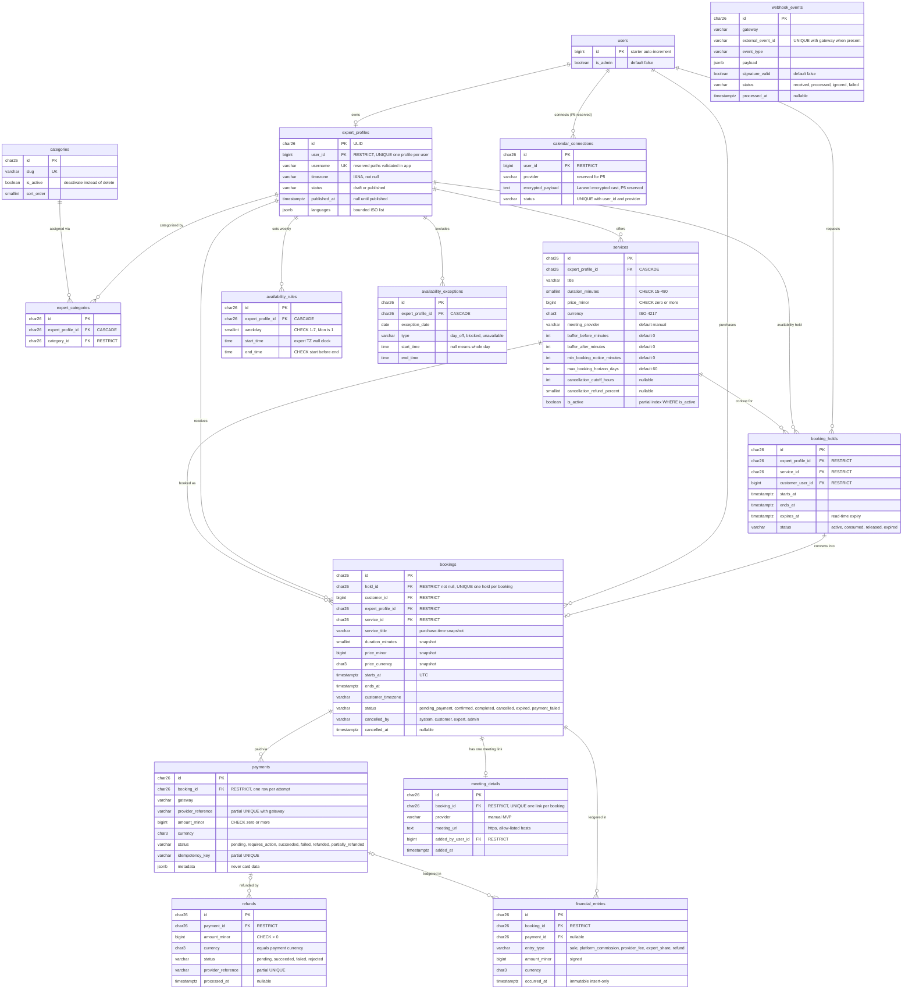

# Task 0.5 — Mermaid ERD

- **Project:** OpenPeer
- **Phase:** 0 — Architecture & Planning (Output: Mermaid ERD)
- **Status:** ✅ Approved — delivered and persisted at the user's request
- **Date:** 2026-10-20
- **Source:** Visualizes the schema approved in Task 0.4 (PostgreSQL Data Model) — same decisions, authoritative column lists remain in `0.4-postgresql-data-model.md`
- **Rendering note:** Mermaid v10+ `erDiagram` syntax; PK/FK/UK attribute markers; **ERD cannot express composite/partial/EXCLUDE constraints** — they are listed separately in §2 (do not misread "UK only" as the full constraint set)

---

## 1. Full ERD

Principle: the ERD shows **relations + keys + status values**; exhaustive columns/limits remain in 0.4.

Framework-owned tables (`users` partially, `notifications`) are outside the ERD's relation graph; starter columns of `users` are trimmed for readability.

## 2. Constraint Map (what ERD cannot express)

| Constraint type | Table | Definition |
|---|---|---|
| Partial UNIQUE | `payments` | `(gateway, provider_reference) WHERE provider_reference IS NOT NULL` |
| Partial UNIQUE | `payments` | `(idempotency_key) WHERE idempotency_key IS NOT NULL` |
| Partial UNIQUE | `refunds` | `(gateway, provider_reference) WHERE provider_reference IS NOT NULL` |
| Partial UNIQUE | `bookings` | `(hold_id)` — one hold produces at most one booking |
| UNIQUE | `expert_profiles` | `username`, plus `user_id` (single profile per user) |
| UNIQUE (composite) | `availability_rules` | `(expert_profile_id, weekday, start_time, end_time)` |
| UNIQUE (expression) | `availability_exceptions` | `(expert_profile_id, exception_date, COALESCE(start_time,'00:00'), COALESCE(end_time,'23:59:59'))` |
| UNIQUE (composite) | `expert_categories` | `(expert_profile_id, category_id)` |
| UNIQUE | `meeting_details` | `(booking_id)` |
| UNIQUE | `calendar_connections` | `(user_id, provider)` |
| **EXCLUDE (gist)** | `booking_holds` | `(expert_profile_id WITH =, tstzrange(starts_at, ends_at) WITH &&) WHERE status='active'` — active holds cannot overlap |
| **EXCLUDE (gist)** | `bookings` | `(expert_profile_id WITH =, tstzrange(starts_at, ends_at) WITH &&) WHERE status IN ('confirmed','completed')` — confirmed overlaps impossible at DB level |
| CHECK | all touched tables | Domains/ranges as recorded column-by-column in 0.4 |
| Partial INDEX | public queries | `services WHERE is_active`; `expert_profiles WHERE status='published'`; `bookings` pending scan; webhook retry scan; hold expiry scan |

## 3. Acceptance Criteria

- ✅ Every FK from the approved 0.4 schema is represented with matching cardinalities (1-1 pairs: `users`↔`expert_profiles` via UNIQUE, `bookings`↔`meeting_details`, hold↔booking via UNIQUE).
- ✅ Reserved (`calendar_connections`) and framework tables separated clearly.
- ✅ Everything ERD syntax cannot show is recorded in the constraint map (§2).
- ✅ Standard Mermaid v10+ `erDiagram`; renders via mermaid.live or IDE preview; will be embedded into docs during Phase 1.6 for a permanent, CI-friendly rendering check.

---

## Appendix — Workflow

- **Task 0.5 delivered and approved:** this document.
- **Next proposed task:** 0.6 — Booking & Scheduling Design (state machine, slot generation, conflict-prevention strategy, hold lifecycle, DST edge rules, concurrency test plan).
- Earlier outputs: `0.1-product-scope-and-mvp.md`, `0.2-technology-decision-record.md`, `0.3-modular-monolith-architecture.md`, `0.4-postgresql-data-model.md`.
