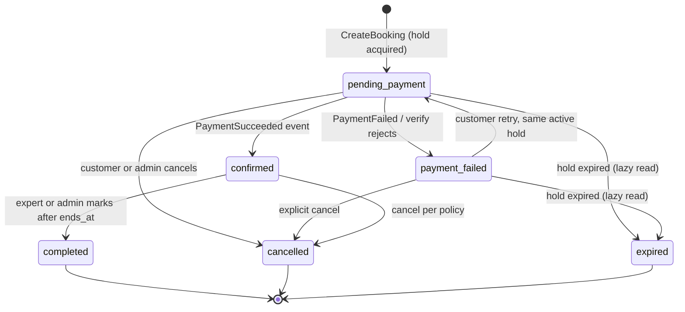

# Task 0.6 — Booking & Scheduling Design

- **Project:** OpenPeer
- **Phase:** 0 — Architecture & Planning (Output: Booking State Diagram + Scheduling/Conflict Strategy)
- **Status:** ✅ Approved — delivered and persisted at the user's request
- **Date:** 2026-10-20
- **Source:** Master Development Prompt v3.0, §7.4, §7.5, §10; builds on 0.2 (D-09 time rules), 0.3 (module boundaries), 0.4 (schema incl. `booking_holds` ownership by Scheduling)
- **Documented decisions added here:** D-13 (conflict-prevention mechanism), D-14 (hold TTL)
- **Note:** Planning artifact. Implementation lands in Phase 3 tasks; concurrency proofs run on real PostgreSQL (D-04). One clarification vs. the in-chat draft: the `payment_failed` transitions were cleaned up here (retry → pending_payment; explicit cancel → cancelled; abandoned + hold expired → expired).

---

## 1. Booking State Machine



### 1.1 Transition Matrix (actor + precondition + side effects)

| From → To                          | Trigger and actor                                     | Precondition                                                             | Side effects                                                                  |
| ---------------------------------- | ----------------------------------------------------- | ------------------------------------------------------------------------ | ----------------------------------------------------------------------------- |
| `* → pending_payment`              | Customer (authenticated) via `CreateBookingAction`    | Scheduling `AcquireHoldAction` succeeded; **price computed server-side** | hold `active`; booking row `pending_payment`; payment initiation follows      |
| `pending_payment → confirmed`      | **Payments event only** (`PaymentSucceeded` listener) | booking `pending_payment` AND hold `active`                              | atomic hold `consumed`; `financial_entries` inserted; notifications event     |
| `pending_payment → payment_failed` | Payments event / server verification                  | gateway rejects or failure event                                         | payment row `failed`; **hold `released`** (slot frees)                        |
| `payment_failed → pending_payment` | Customer retry                                        | same booking; hold still `active` and not expired                        | new `payments` attempt row                                                    |
| `pending_payment → expired`        | Scheduling lazy read                                  | hold `expired` (`expires_at < now`)                                      | booking stamped `expired` — **no worker required**                            |
| `pending_payment → cancelled`      | Customer / Admin (Policies)                           | —                                                                        | hold `released`                                                               |
| `payment_failed → cancelled`       | Customer / Admin (Policies)                           | —                                                                        | hold already released                                                         |
| `payment_failed → expired`         | Scheduling lazy read                                  | hold TTL passed without retry                                            | terminal                                                                      |
| `confirmed → completed`            | Expert / Admin dashboard action                       | `ends_at < now()`                                                        | auto-complete is POST-MVP (needs scheduler)                                   |
| `confirmed → cancelled`            | Customer / Expert / Admin (Policies)                  | cancellation policy (cutoff, refund %) — refund decision in 0.7          | hold already consumed; `cancelled_by/at/reason` recorded; notifications event |

**Forbidden transitions** (guarded in app, enforced by transition map + tests): `confirmed → pending_payment`; `expired → *`; `cancelled → *`; `completed → *`; `payment_failed → confirmed` (never directly). Illegal status values are barred by the CHECK constraint in 0.4.

## 2. Slot Generation (`CalculateSlotsAction`)

Inputs: `services` (duration, buffers, min notice, max horizon), `expert_profiles.timezone`, `availability_rules`, `availability_exceptions`, existing `bookings (confirmed/completed)`, active `booking_holds (status='active' AND expires_at > now)`.

Algorithm (server-side, UTC instant math):

1. Window: from `max(now + min_booking_notice, today 00:00 in expert TZ)` to `today + max_booking_horizon_days`.
2. Per day: match `availability_rules` rows by `weekday` (ISO 1–7); convert each `start_time/end_time` wall-clock pair (expert TZ) into **UTC instants**.
3. Apply exceptions: `day_off` → drop the day; interval exceptions (`blocked`/`unavailable`) → subtract ranges from the window.
4. Build the busy set (union of overlapping ranges); extend every busy interval by the service buffers: `[start − buffer_before, end + buffer_after)` — buffers are expert-wide for slot placement and come from the service config.
5. Emit candidate slots as **half-open intervals `[s, s + duration)`**; a candidate must fit fully inside its available window (`s + duration <= window_end`).
6. Remove candidates intersecting the busy union.
7. Return slots (paginated); a chosen slot is **re-validated on the server at selection time** (see security note).

### Timezone/DST Rules

| Situation                                    | Rule                                                                                                                        |
| -------------------------------------------- | --------------------------------------------------------------------------------------------------------------------------- |
| Wall-clock rule → UTC conversion             | Carbon + tzdb (IANA), date-aware per conversion — no cached offsets                                                         |
| Spring-forward gap (wall time nonexistent)   | Rare for typical hours (e.g. 09:00); documented policy: gap-resolved forward (+1h) via Carbon; edge tests included          |
| Fall-back ambiguity (wall time occurs twice) | `start_time` resolves to the **earlier offset** instance; `[start,end)` stays continuous                                    |
| 30/45-minute offset regions                  | Native `timestamptz` handling; one such zone in the test set                                                                |
| Slot spanning a DST transition               | Correct by construction since instants are UTC; a fall-crossing test (e.g. `Europe/Istanbul` 2026 transition date) included |

**Security note:** client-provided `starts_at` is never trusted — at selection the server re-validates the instant against `CalculateSlotsAction` output plus `AssertIntervalFree` inside the hold transaction. `customer_timezone` (validated IANA) is a display-only snapshot.

## 3. Conflict Prevention — Final Decision (D-13)

| Option                                           | Evaluation                                                                                                                                                                                                                                                           |
| ------------------------------------------------ | -------------------------------------------------------------------------------------------------------------------------------------------------------------------------------------------------------------------------------------------------------------------- |
| Row locks only (advisory / FOR UPDATE)           | App bugs could silently allow conflicts; no DB-level guarantee                                                                                                                                                                                                       |
| EXCLUDE constraints only                         | Single layer; correct **only if all busy-state lives in range-carrying rows** — which this model guarantees (holds and bookings both carry `tstzrange`)                                                                                                              |
| **Both: EXCLUDE + per-expert row lock (chosen)** | **Defense in depth:** serialization avoids retry churn; EXCLUDE is the database-level guarantee that survives any future code path mistake — the master prompt's hard requirement "never confirm two overlapping bookings" is not dependent on frontend or app logic |

**Mechanism (pseudocode):**

```text
AcquireHoldAction (transaction):
  BEGIN;
    SELECT 1 FROM expert_profiles WHERE id = :expert FOR UPDATE;  -- per-expert mutex (cheap row lock)
    -- re-validate: slot exists in generated set; overlaps none of
    --   bookings (confirmed/completed) or holds (active AND expires_at > now)
    INSERT INTO booking_holds (..., status='active', expires_at = now()+TTL);
    -- last line: EXCLUDE USING gist (expert_profile_id WITH =, tstzrange(starts_at, ends_at) WITH &&)
    --   WHERE status='active'  → SQLSTATE 23P01 ⇒ slot effectively taken
  COMMIT;

ConfirmBooking (PaymentSucceeded listener) — atomic hold consumption:
  UPDATE booking_holds SET status='consumed', updated_at=now()
   WHERE id = :hold AND status='active' AND ends_at > now();
  -- affected_rows = 0 ⇒ cannot confirm (idempotent against event races)
  INSERT INTO bookings (hold_id, ...);  -- UNIQUE(hold_id) blocks double-confirm
  -- EXCLUDE ...(status IN ('confirmed','completed')) blocks overlaps as backstop

ReleaseHold: UPDATE ... SET status='released' WHERE id=:id AND status='active';  -- idempotent
```

**Hold TTL (D-14):** `scheduling.hold_ttl_seconds`, default **900** (15 min), config-driven. Expiry is **workerless**: every read predicates `status='active' AND expires_at > now()`; any reader that encounters an outlived hold lazily stamps the tied `pending_payment` booking as `expired` (idempotent UPDATE). A periodic sweep command that merely _materializes_ statuses for reporting is POST-MVP (scheduler approval required) and is **not** needed for correctness.

**`btree_gist` prerequisite:** `CREATE EXTENSION IF NOT EXISTS btree_gist;` applied by the Phase 1.2 baseline migration (PostgreSQL 17 image ships it). If unavailable, migrations fail loudly — the constraint set is never silently skipped.

## 4. Concurrency Test List (Phase 3 — real PostgreSQL; SQLite is not a substitute)

| #   | Test                                                  | Expected                                                  |
| --- | ----------------------------------------------------- | --------------------------------------------------------- |
| C1  | Two parallel `AcquireHold` for the same slot          | exactly one active hold; the other rejected               |
| C2  | Active hold vs. confirmed booking overlap             | each blocks the other (lock + EXCLUDE composing)          |
| C3  | Confirmed + confirmed overlapping insert              | `SQLSTATE 23P01`; booking rejected                        |
| C4  | Outlived hold                                         | slot regenerable; lazy `expired` stamps booking           |
| C5  | **Consume race**: two `PaymentSucceeded` for one hold | exactly one `confirmed`; other event idempotently ignored |
| C6  | Released hold                                         | slot immediately re-acquirable                            |
| C7  | DST spring gap / fall ambiguity                       | continuous slot list across the boundary                  |
| C8  | 30/45-minute offset region                            | correct UTC instants in slots and bookings                |

Test technique: two separate PDO connections per scenario; the framework's global test transaction wrapping is disabled for these (see 0.8's test strategy for the exact wiring).

## 5. Deferred Records (feeds 0.8)

- `pg_advisory_xact_lock` evaluation: deferred with a measurement trigger (only if `FOR UPDATE` serialization shows retry storms).
- Hold-expiry background sweeper: POST-MVP (scheduler approval).
- Appointment/meeting-link reminders: Phase 5 (needs scheduling infra approval).

## 6. Acceptance Criteria

- ✅ Full state set + transition matrix; every state reachable and terminating; forbidden transitions listed and testable.
- ✅ Slot generation fully specified (inputs, exceptions, buffers, `[start,end)` half-open rule) with a security-first re-validation step.
- ✅ D-13 (EXCLUDE + row lock) and D-14 (TTL) decisions justified with alternatives; the DB-level guarantee does not trust frontend.
- ✅ Workerless expiry defined by read-time semantics; background sweep explicitly optional POST-MVP.
- ✅ DST/edge-case rules recorded; 8 real-PostgreSQL concurrency tests enumerated.
- ✅ External calls stay outside DB locks (locking scope limited to the hold transaction).

---

## Appendix — Workflow

- **Task 0.6 delivered and approved:** this document.
- **Next proposed task:** 0.7 — Payment Design (PaymentGateway contract, MockPaymentGateway behavior, webhook idempotency, financial records, Payment Flow Diagram).
- Earlier outputs: `0.1` … `0.5`.
