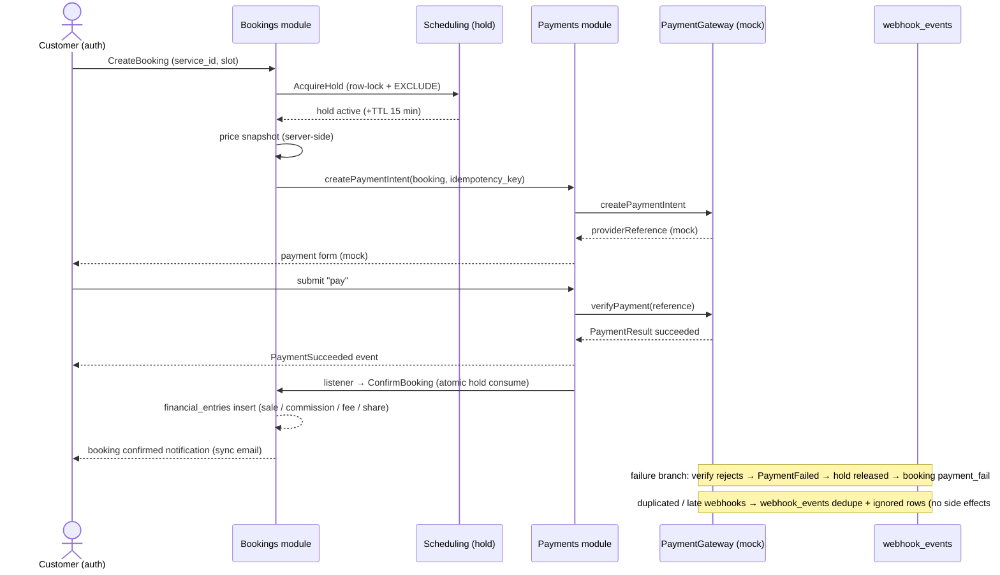

# Task 0.7 — Payment Design

- **Project:** OpenPeer
- **Phase:** 0 — Architecture & Planning (Output: Payment Flow Diagram + Gateway/Financial Model)
- **Status:** ✅ Approved — delivered and persisted at the user's request
- **Date:** 2026-10-20
- **Source:** Master Development Prompt v3.0, §7.6 (Payments), §9 (webhook auth/idempotency), §10; builds on 0.4 (`payments`/`refunds`/`webhook_events`/`financial_entries` schemas) and 0.6 (booking events, hold consume, EXCLUDE layers)
- **Note:** Planning artifact. The gateway contract and driver logic are implemented in Phase 4 tasks; only `MockPaymentGateway` is planned for MVP (real providers are separate approved tasks — matrix rows 34/36).

---

## 1. `PaymentGateway` Contract (interface sketch)

Located later at `app/Modules/Payments/Contracts/PaymentGateway.php`; implementations in `Payments/Implementations/` (0.3). The contract covers the five operations required by §7.6 plus two helpers:

| Method | Contract behavior |
|---|---|
| `createPaymentIntent(PaymentIntentRequest $request): PaymentIntent` | Takes booking + **server-computed** amount + `idempotencyKey`; returns a `providerReference` (synthetic under mock) |
| `verifyPayment(string $providerReference): PaymentResult` | Queries the provider and returns the authoritative result — **redirect/frontend evidence is never accepted** |
| `handleWebhook(ParsedWebhook $webhook): WebhookEffect` | Signature verification + event parsing; integration rules in §4 |
| `queryTransaction(string $providerReference): PaymentResult` | Remedy for missing/late/dropped webhooks; `verifyPayment` uses the same path |
| `refund(RefundRequest $request): RefundResult` | Idempotent refund; provider reference round-trip |
| `estimateProviderFee(int $amountMinor, string $currency): int` | Provider fee estimate (mock: **0**) |
| `supportsCurrency(string $currency): bool` | Early validation (MVP: TRY/USD/EUR) |

**Binding:** `config/payments.php` → `driver` key; `PaymentsServiceProvider` (Phase 4) binds `PaymentGateway::class`. Unknown driver name → exception (fail-fast).

## 2. `MockPaymentGateway` Behavior Matrix

Implements the same `PaymentGateway` contract; scenarios are chosen per attempt (config/metadata):

| Scenario | Behavior | Expected outcome |
|---|---|---|
| `success` | default, deterministic | `verifyPayment`/webhook → `succeeded` |
| `pending_then_success` | two webhook events deliver the final outcome | polling/webhook → `succeeded` |
| `always_fail` | verify rejects + webhook delivers `PaymentFailed` | booking → `payment_failed` |
| `timeout` | no webhook event at all | recovery via `queryTransaction` (customer/admin polling) |
| `duplicate_webhook` | same `external_event_id` delivered **N times** | **one** side effect recorded |
| `late_pending` | `pending` arrives after `succeeded` | **ignored** (§4 backward rule) |

**Production guard (§7.6 hard requirement):** `MockPaymentGateway::createPaymentIntent` throws `RuntimeException` when `app()->environment('production')`. The production-readiness checklist (Phase 1.6, §12 of the master prompt) adds a config check: `payments.driver` must never be `mock` in production. Tests exercise the guard itself.

## 3. Server-Side Amount Validation

- Price is computed **only on the server**: `CreateBookingAction` pulls the snapshot from Services (0.4 columns `price_minor`, `price_currency`, `cancellation_*`, `meeting_provider`); the client sends only `service_id` + the chosen slot.
- The `amount_minor` at intent creation is compared to `bookings.price_minor`; mismatches abort.
- Money never touches floating point (D-07; integer minor units everywhere).
- Refunds re-read the booking snapshot — purchase-time protection against later price edits (§7.3).

## 4. Webhook Idempotency Rules (active even under mock)

| Rule | Behavior |
|---|---|
| Signature verification fails | HTTP 401; row stored with `signature_valid=false`, never processed |
| Duplicate `external_event_id` | DB level: unique on `(gateway, external_event_id)` blocks a second row; HTTP 200 acknowledged — **no new side effects** |
| Late / out-of-order (backward) transitions | e.g. `pending` after `succeeded`: stored as `ignored`; **no backward state movement** (monotonic progression per 0.6 matrix) |
| Unknown event types | Row marked `ignored`; HTTP 200 (avoid provider-level failing of feed) |
| Idempotency key | App-generated per attempt; provider-referenced joins deduplicate retries |
| Logging / data hygiene | No links/PII passthrough logging; `payload` retained for audit only |

`webhook_events` records every signal — this architecture ships before the first real provider (Phase 4).

## 5. Financial Records Model (`financial_entries`)

| entry_type | Sign | When | Meaning |
|---|---|---|---|
| `sale` | + | PaymentSucceeded | gross from booking price snapshot |
| `platform_commission` | − | PaymentSucceeded | platform share (`payments.platform_commission_bps`, e.g. 500 = 5%) |
| `provider_fee` | − | PaymentSucceeded | gateway fee estimate (mock: **0**) |
| `expert_share` | + | PaymentSucceeded | `sale − commission − fee` (net eligible payout record, **not transferred**) |
| `refund` | − | RefundSucceeded | refunded portion — commission/expert share reversal applies proportionally |

- Entries are inserted **in the same DB transaction** as the state transition (0.6 listener rule).
- Payout execution is POST-MVP (no fund custody — matrix rows 33/52); payout eligibility is computed as aggregate expert share minus refund deductions from `financial_entries`.
- Single currency per booking in MVP; multi-currency is POST-MVP (Phase 6).

## 6. Payment Flow Diagram (MVP — Mock gateway, sync)

**Note:** notifications run **sync** in MVP (0.2 D-11) inside listeners; the mock checkout UI polls and renders the result; no queue workers exist.

## 7. Deferred Items

- Real provider integrations (Iyzico/Stripe): Phase 5, separate approved tasks (matrix rows 34/36).
- Asynchronous webhook queue processing: after the queue decision (Phase 5).
- Payout execution: POST-MVP; only `financial_entries` records exist in MVP.

## 8. Acceptance Criteria

- ✅ Gateway contract covers all §7.6 operations + fee/currency helpers; provider substitution is a config change.
- ✅ Mock has 6 deterministic scenarios + a **production guard**; the mock can never confirm real purchases.
- ✅ Repeated webhooks cannot create duplicate effects (DB unique on `(gateway, external_event_id)`); late/backward signals are stored as `ignored` with no state movement.
- ✅ Prices validated server-side only; no floating point.
- ✅ Failed payments never produce `confirmed` bookings (confirmation requires `PaymentSucceeded` only); holds release on failure; timeouts can be resolved via `queryTransaction`.
- ✅ Booking/payment state movement is monotonic; financial records cover gross/commission/fees/share/refunds; payout is explicitly POST-MVP.

---

## Appendix — Workflow

- **Task 0.7 delivered and approved:** this document.
- **Next proposed task:** 0.8 — Security Assessment + Technical Risk Register + Test Strategy + **Phase 1 Task Plan** (final Phase 0 task).
- Earlier outputs: `0.1` … `0.6`.
